

  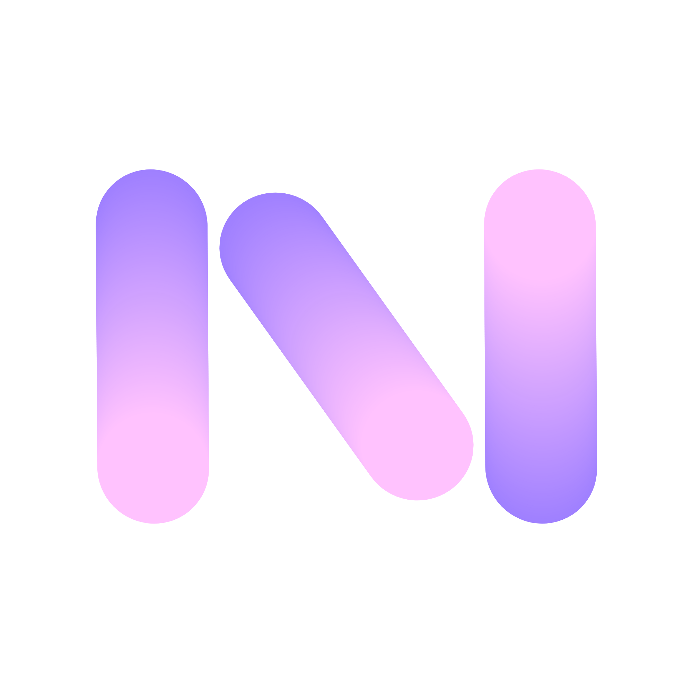

<h1 align="center">NotNotch</h1>

  <b>A Dynamic Island for the top of your screen, on Windows and macOS.</b>

  
  

  
  
  
  
  

  <a href="https://github.com/latiefahmad/notnotch/releases/latest"><b>Download</b></a>
  &nbsp;·&nbsp;
  <a href="#features"><b>Features</b></a>
  &nbsp;·&nbsp;
  <a href="#your-data-stays-on-your-pc"><b>Privacy</b></a>
  &nbsp;·&nbsp;
  <a href="https://github.com/latiefahmad/notnotch/issues/new/choose"><b>Suggest an idea</b></a>

https://github.com/user-attachments/assets/9763d3c0-d17e-4fb4-8d0d-dfa104ea5fb8

## What it is

A notch at the edge of your Windows or Mac screen that opens on hover, click or **Ctrl + Alt + Space** and holds the tools you reach for all day. Free and open source.

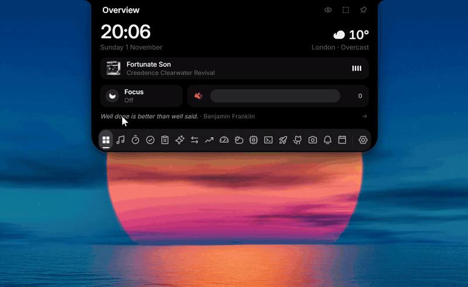

## Features

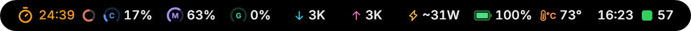 <b>The closed notch</b>: cover, timer, title or lyrics, AI quota, CPU, RAM, GPU, network, power, battery, temperature, clock and GitHub in one row, rotating when it doesn't fit. A notch, a capsule or a line, on any screen edge and in the size you choose, with a colour for each icon if you want one.

<table>
  <tr>
    <td width="50%" valign="top">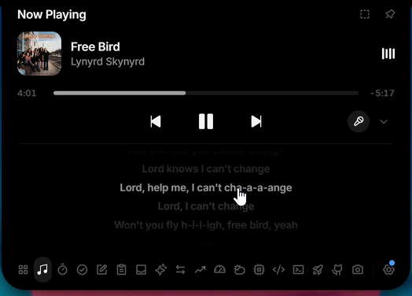 <b>Now Playing</b>: any player, with a live equalizer and synced lyrics, word by word where the source times words, with translation and romanisation for Japanese, Chinese and Korean</td>
    <td width="50%" valign="top">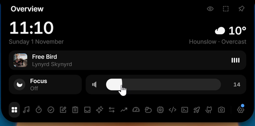 <b>Overview</b>: time, weather, the song playing, focus and volume</td>
  </tr>
  <tr>
    <td valign="top">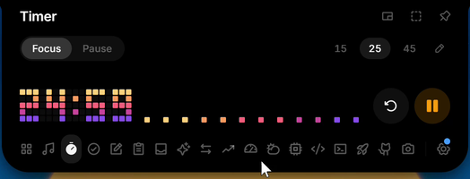 <b>Timer</b>: focus and break presets in big pixel digits</td>
    <td valign="top">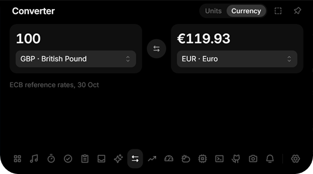 <b>Converter</b>: units, and currencies at the ECB rates</td>
  </tr>
  <tr>
    <td valign="top">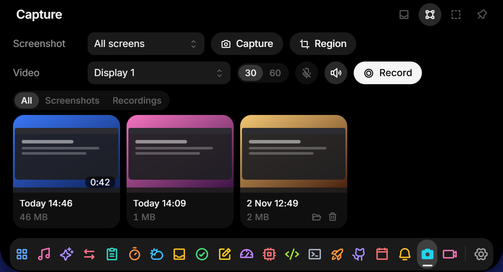 <b>Capture</b>: screenshots and recordings with system audio and mic</td>
    <td valign="top">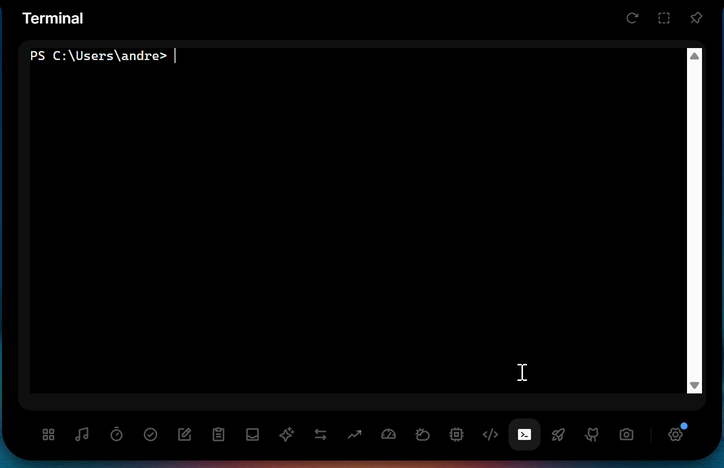 <b>Terminal</b>: PowerShell or Command Prompt inside the notch</td>
  </tr>
  <tr>
    <td valign="top">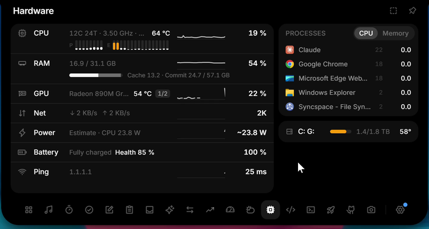 <b>Hardware</b>: CPU, GPU, RAM, network, power, temperatures and FPS</td>
    <td valign="top">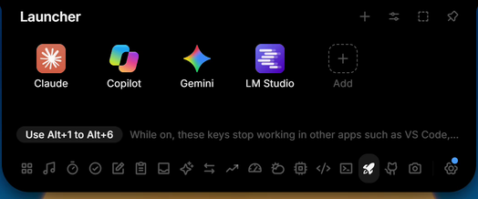 <b>Launcher</b>: your pinned apps, one click away</td>
  </tr>
  <tr>
    <td valign="top">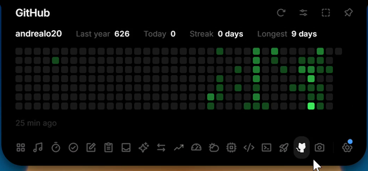 <b>GitHub</b>: contribution calendar, today's count and streaks</td>
    <td valign="top">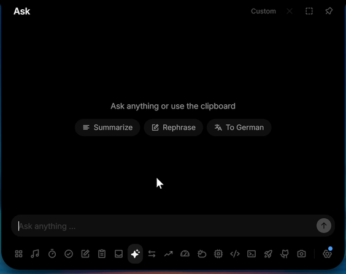 <b>Ask</b>: chat with the AI provider you choose, with your own key</td>
  </tr>
  <tr>
    <td valign="top">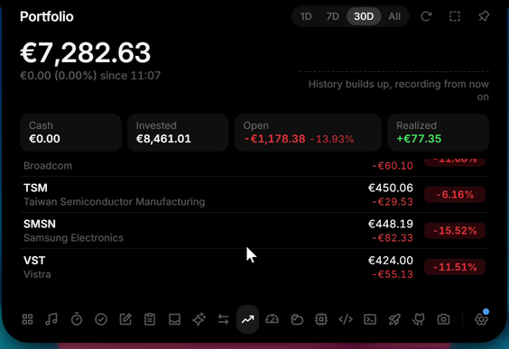 <b>Portfolio</b>: several brokers in one currency, read only</td>
    <td valign="top">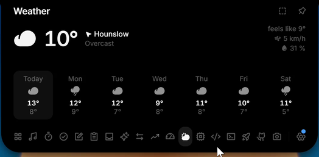 <b>Weather</b>: current conditions and a 7-day forecast</td>
  </tr>
  <tr>
    <td valign="top">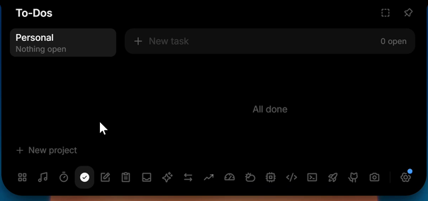 <b>To-dos</b>: projects, due times and reminders</td>
    <td valign="top">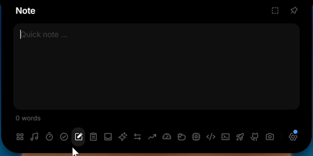 <b>Notes</b>: a quick note, saved as you type</td>
  </tr>
  <tr>
    <td valign="top">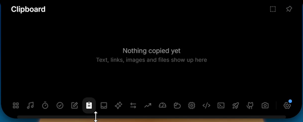 <b>Clipboard</b>: text, links, images and files, never written to disk</td>
    <td valign="top">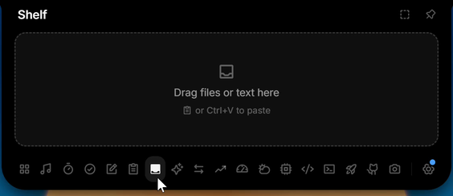 <b>Shelf</b>: a parking spot for files, dropped or pasted</td>
  </tr>
  <tr>
    <td valign="top">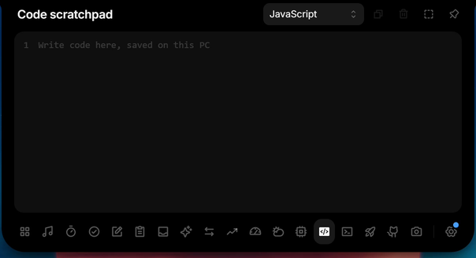 <b>Scratchpad</b>: code with syntax colouring, one draft per language</td>
    <td valign="top">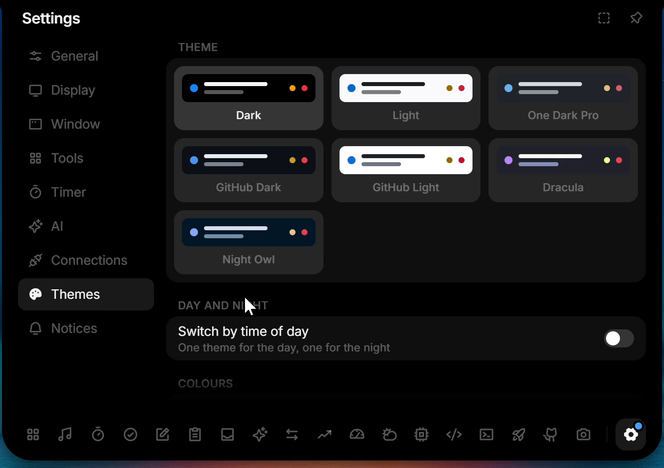 <b>Themes</b>: fifteen built in, an editor, coloured icons and a day and night switch</td>
  </tr>
  <tr>
    <td valign="top">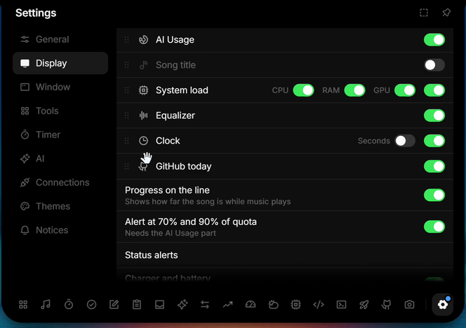 <b>The closed row</b>: pick and order what it shows</td>
    <td valign="top">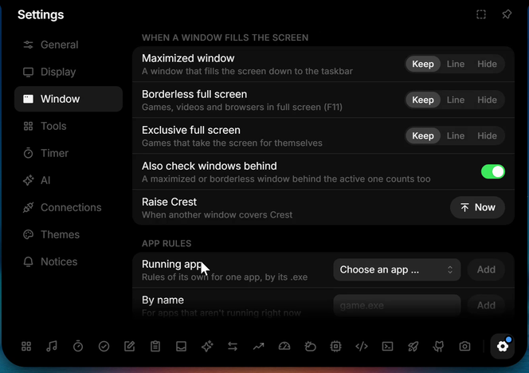 <b>Window rules</b>: keep, shrink to a line or hide over full-screen apps</td>
  </tr>
  <tr>
    <td valign="top">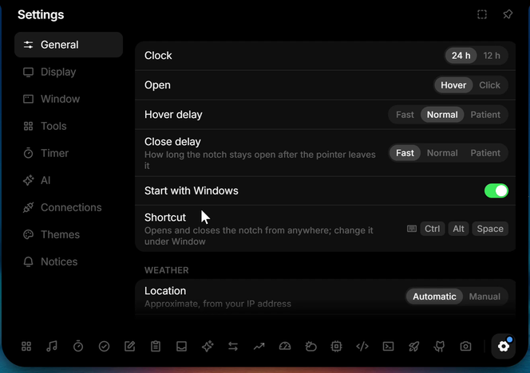 <b>General</b>: hover or click, delays, autostart and your shortcut</td>
    <td valign="top">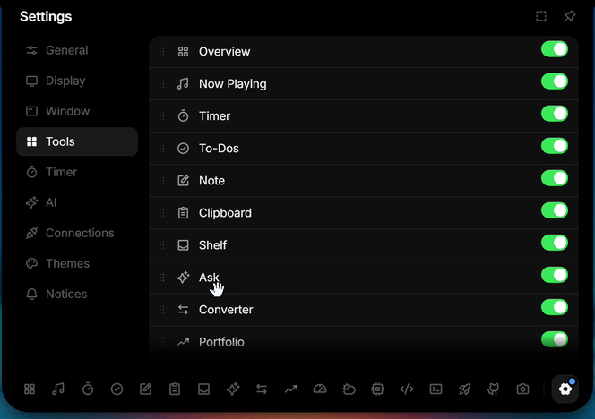 <b>Tools</b>: reorder, hide and tune every tool</td>
  </tr>
</table>

Also in the notch: a read-only calendar agenda from ICS links (Google, Outlook, iCloud) or CalDAV, with a notice before each event and the next event in the closed row, a password and 2FA vault, Windows notifications with a history page, `notnotch-notify` for scripts and builds, status alerts with a volume and brightness HUD, your Discord call and privacy dots for the mic, camera and screen recording.

Plugins add your own tools: a folder of HTML, CSS and JavaScript with a `notnotch-plugin.json`, installed from **Settings → Plugins**, running sandboxed with only the network addresses and storage it declares ([docs/plugins.md](docs/plugins.md)). Scripts can also put their own parts in the closed row with `notnotch-notify part`.

A short first-run setup picks a preset (Music, Productivity, AI or your own tools), the closed look and edge, and shows how to open the notch; Settings → General runs it again.

The interface is English by default; Bahasa Indonesia is available in Settings → General.

With more than one monitor the notch stays on the one you pick, follows the pointer from monitor to monitor, or shows a closed notch on every monitor that opens where you touch it.

Every feature in detail, with setup steps for each integration: [docs/features.md](docs/features.md).

## New in 1.0.0

<table>
  <tr>
    <td width="50%" valign="top">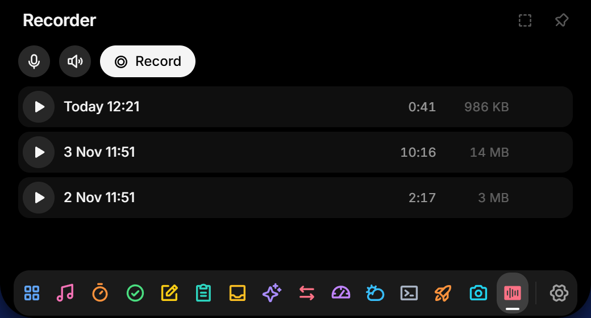 <b>Recorder</b>: sound only, from the microphone, the system audio or both, so a call keeps every voice. M4A files in Music, off until you turn it on in Settings, Tools</td>
    <td width="50%" valign="top">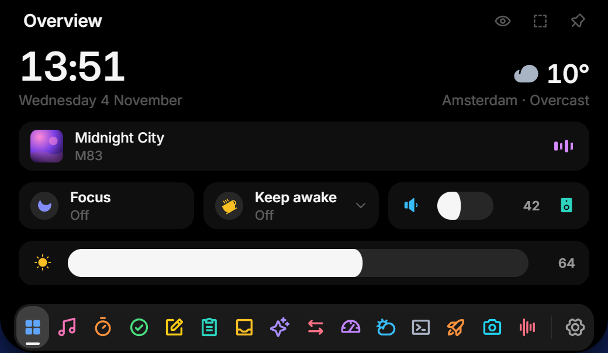 <b>Brightness</b> of the screen the notch is on, from Overview: external monitors over DDC/CI and a laptop's own screen</td>
  </tr>
  <tr>
    <td valign="top">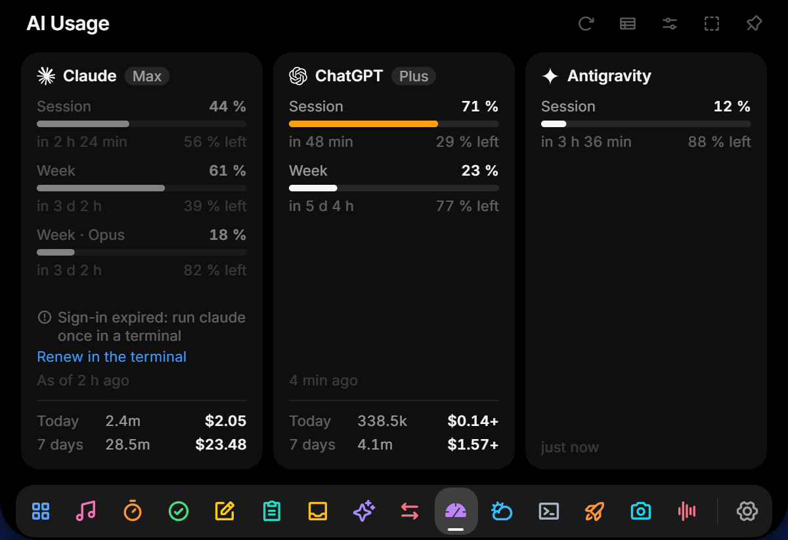 <b>AI usage</b> says when a reading is out of date and dims it; an expired sign-in renews from NotNotch's terminal in one click</td>
    <td valign="top">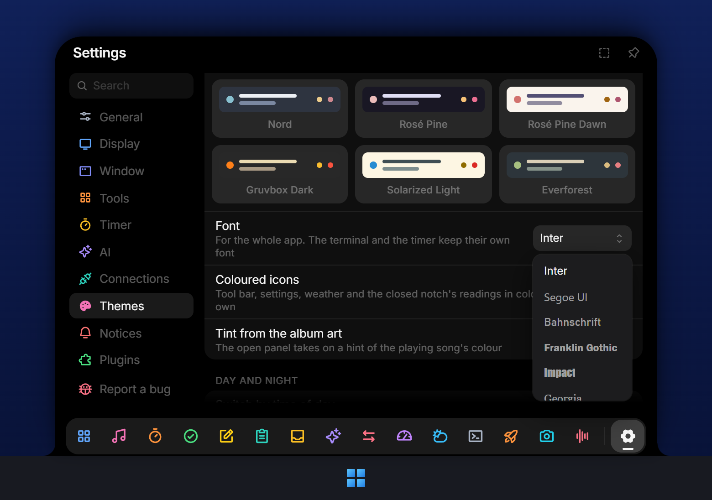 <b>Fonts</b> for the whole app, sixteen of them, and menus that open upright with the notch on the bottom or a side edge. <b>Report a bug</b> sits below Plugins</td>
  </tr>
</table>

Also new: a click on a notice opens what it is about (What's new, the recording, AI usage or Now Playing). All the details: [1.0.0](docs/releases/v1.0.0.md) release notes.

## Install

- **Microsoft Store:** [NotNotch](https://apps.microsoft.com/detail/9N2KXJ2924KS), signed by Microsoft and kept up to date by the Store.
- **Installer:** download `NotNotch_x.y.z_x64-setup.exe` (or `NotNotch_x.y.z_arm64-setup.exe` on a Windows on ARM PC) from the [latest release](https://github.com/latiefahmad/notnotch/releases/latest) and run it. It installs for your user only. The installer is not code-signed yet, so SmartScreen may warn on first launch: click **More info → Run anyway**.
- **Portable:** unzip `NotNotch-x.y.z-Portable-x64.zip` (or `-Portable-arm64.zip`) anywhere you can write to and run `NotNotch.exe`. Nothing is installed.
- **Mac (preview):** download `NotNotch_x.y.z_aarch64.dmg` for Apple silicon or `NotNotch_x.y.z_x64.dmg` for Intel and drag NotNotch to Applications. The app is not notarized yet, so macOS refuses it on first launch: open **System Settings → Privacy & Security → Open Anyway**. Shelf, Hardware, Discord, Vault, Terminal, Launcher, Notices and Capture are Windows-only for now and don't show on a Mac.

Every release has a `SHA256SUMS` file with the SHA-256 of each download, to check with `sha256sum -c SHA256SUMS --ignore-missing` or `Get-FileHash`.

Windows 11 or Windows 10, 64-bit (x64 or ARM64), or macOS 12 or later on Apple silicon or Intel (preview).

## Your data stays on your PC

No account, no analytics, no tracking. Settings and data stay on your machine, keys live in the Windows Credential Manager (the Keychain on a Mac), and NotNotch only goes online for the services you turn on. What goes over the network, and when: [PRIVACY.md](PRIVACY.md).

## Support the project

NotNotch is free, with no ads and no paid tier. If it is useful to you, [sponsor it on GitHub Sponsors](https://github.com/sponsors/latiefahmad), [support it on Saweria](https://saweria.co/latiefahmad), star the repository or [suggest an idea](https://github.com/latiefahmad/notnotch/issues/new/choose).

Building from source and contributing: [CONTRIBUTING.md](CONTRIBUTING.md).

## Credits and licences

NotNotch is a modified version of [L4-Notchbar](https://github.com/Linux5Real/L4-Windows-NotchBar) by Linux5Real, forked from version 1.6.0 on 31 October 2026. The commit history lists every change since then.

- The Antigravity quota reader comes from an upstream pull request by [Fraustiz](https://github.com/Linux5Real/L4-Windows-NotchBar/pull/11).
- The LRCLIB lookup (exact match, search fallback by length, cleanup of video titles) follows an upstream pull request by mhmmdazizy ([L4-Notchbar PR #13](https://github.com/Linux5Real/L4-Windows-NotchBar/pull/13)).
- The layout of the collapsed row, the carousel timing, the capsule placement rules, the per-app audio capture, the way live notices learn of new Windows notifications from the event log, the screen-edge frame, the side column, the portable packaging, the window and app rules, the shortcut text and the panel sizes and scale are translated from [BrimDeck](https://github.com/MoFeng2223/BrimDeck) (Apache-2.0, license text in [licenses/BrimDeck-LICENSE](licenses/BrimDeck-LICENSE)).
- The panel themes, their readability correction and the day and night switch are translated from BrimDeck too ([docs/themes.md](docs/themes.md)). The One Dark Pro, GitHub, Dracula, Night Owl, Catppuccin, Nord, Rosé Pine, Gruvbox, Solarized and Everforest themes use the colours of those palettes under the MIT License ([licenses/theme-palettes-MIT.txt](licenses/theme-palettes-MIT.txt)).
- Hiding the Windows volume and brightness indicator follows [Bloom](https://github.com/SehajveerSingh2005/bloom) (GPL-3.0, license text in [licenses/Bloom-LICENSE](licenses/Bloom-LICENSE)).
- The notch proportions were derived from [NotchDrop](https://github.com/Lakr233/NotchDrop) (MIT).
- The terminal uses [xterm.js](https://github.com/xtermjs/xterm.js) (MIT, [licenses/xterm-MIT.txt](licenses/xterm-MIT.txt)).
- Pinyin for Chinese lyrics comes from [rust-pinyin](https://github.com/mozillazg/rust-pinyin) (MIT, [licenses/pinyin-MIT.txt](licenses/pinyin-MIT.txt)). Kanji readings use [JMdict](https://www.edrdg.org/wiki/index.php/JMdict-EDICT_Dictionary_Project) by the Electronic Dictionary Research and Development Group (CC BY-SA 4.0) in the [jmdict-simplified](https://github.com/scriptin/jmdict-simplified) format, downloaded on demand and not shipped with NotNotch.
- The text is set in [Inter](https://github.com/rsms/inter) (SIL Open Font License 1.1, [licenses/Inter-OFL.txt](licenses/Inter-OFL.txt)), bundled through Fontsource.
- The icons are [Phosphor](https://github.com/phosphor-icons/react) (MIT, [licenses/Phosphor-MIT.txt](licenses/Phosphor-MIT.txt)).
- The calendar maps Windows time zone names to IANA names with the table from [jiff](https://github.com/BurntSushi/jiff) (MIT, [licenses/jiff-LICENSE](licenses/jiff-LICENSE)), which also supplies the time zone database.
- The design follows Apple's Dynamic Island and the macOS app OmniNotch. NotNotch is not affiliated with Apple or OmniNotch.
- NotNotch is an independent app by latiefahmad. It is not made, sponsored or endorsed by Microsoft.

## License

[GPL-3.0](LICENSE). You may use, study, change and share this project, also commercially, but any version you distribute must stay open source under the same license and keep the copyright notices.

NotNotch is a fork of L4-Notchbar 1.6.0. The source code of every release, including the Microsoft Store builds, is in this repository: each release has a version tag that points to the exact code it was built from.

## Star history

<a href="https://www.star-history.com/#latiefahmad/notnotch&Date">
  <picture>
    <source media="(prefers-color-scheme: dark)" srcset="https://api.star-history.com/svg?repos=latiefahmad/notnotch&type=Date&theme=dark" />
    <source media="(prefers-color-scheme: light)" srcset="https://api.star-history.com/svg?repos=latiefahmad/notnotch&type=Date" />
    
  </picture>
</a>

