# NotNotch features

Everything NotNotch does, tool by tool. The short version with pictures is in the [README](../README.md).

## First-run setup

- On a new install the open notch starts with a short setup in three steps. **Skip** ends it at any step, and **Settings → General → Setup** runs it again.
- Step 1 picks a preset, which switches tools and parts of the closed row on and off. Overview stays on in each.
  - **Music:** Now Playing and Timer; the closed row shows the song title with the current lyric line, the equalizer and the timer.
  - **Productivity:** Timer, To-dos, Notes, Clipboard, Shelf, Converter and Weather; the row shows the timer and the equalizer.
  - **AI:** Ask, AI Usage and Terminal; the row shows the quota rings and the equalizer.
  - **Custom:** keeps what was there when the setup started (the defaults on a new install) and lets you tick tools one by one. Picking it after another preset undoes that preset.
- Step 2 picks the closed look (notch, capsule or line) and the screen edge.
- Step 3 shows the open shortcut and whether the notch opens on hover or on click.
- Updating from an earlier version never shows it: it only starts by itself when no settings were saved before.

## The closed notch and its row

Pick the closed look under **Settings → Display**.

- **Notch** hugs the top edge like a hardware notch.
- **Capsule** is a pill you can drag up and down to any height. It snaps to the screen edges and the taskbar.
- **Line** is a thin bar with a progress bar for the current song. It shows only the song's progress, and a finished timer.

Notch and capsule show a row of parts, centred and in the order you choose:

- the cover of what is playing, a running timer, your Discord call;
- AI quota rings (one colour per provider);
- song title (or the current lyric line);
- hardware readings: CPU, RAM and GPU, plus network, power, battery and temperature if you turn them on;
- equalizer, clock (with seconds if you like), today's GitHub contributions and your next calendar event;
- parts your scripts set with `notnotch-notify part`: an icon, a short text and a progress bar, which can open a tool or plugin on click;
- downloads in progress, while a browser is downloading something.

Turn each part on or off and drag to reorder them in **Settings → Display**. When the parts do not fit, the row rotates through them like a carousel.

A click on a part opens its tool: the readings open Hardware, the AI rings AI Usage, the cover, title and equalizer the music, the timer and the clock the Timer, the next event the Calendar, script parts Notices and downloads the Shelf. With **Open: Hover** the part under the pointer when the notch opens decides the same way. Anywhere else, or when that tool is off, the notch opens as usual.

**Adjust on the notch**, next to the size in **Settings → Display**, closes the panel and puts the closed notch, capsule or line in a resize mode: drag its ends to change the width (both sides move) and its far side to change the height, double-click a grip for the default, and finish with **Done** or Esc. It neither opens nor moves meanwhile, and the sliders in the settings keep working too.

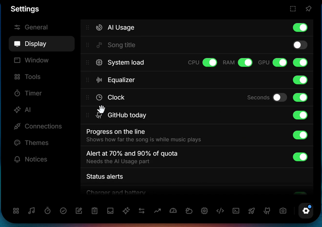

A small cup at the end of the row means keep awake is on (see Overview).
**Downloads** (on by default) shows while a browser downloads into your Downloads folder: a download icon, the size so far and the speed averaged over the last 3 seconds, like "124 MB · 8.2 MB/s", with the count in front when there are several. Browsers give no reliable total size, so there is no percentage. NotNotch spots the partial files browsers write (`.crdownload` for Chrome and Edge, `.part` for Firefox, `.download` and `.partial`) through Windows' change notifications for that folder, not its subfolders, and reads their sizes once a second only while one exists. When a download finishes, a notice says "Downloaded report.pdf" with **Show in folder** and **Add to Shelf**; a cancelled one just disappears. The notice stays quiet during the notices' quiet hours and in presentation mode, and has its own switch in **Settings → Display**. With both the part and the notice off, NotNotch stops watching the folder.

**Privacy dots** turn green when the microphone or camera is in use and red while the screen is being recorded, like on an iPhone.

## Notices

Notices appear over the row, one at a time:

- a running recording, with its time and pause and stop buttons, until it ends;
- a finished timer, until you dismiss it;
- a question from `notnotch-notify ask`, with a button per option, until you answer it or its time runs out (also on the idle line and in focus mode);
- a screenshot or recording just saved, for 4 seconds, with a thumbnail; click it to open the file;
- a finished download, for 6 seconds, with buttons to show it in its folder or add it to the Shelf;
- a status alert (see below);
- a live notice from Windows or `notnotch-notify`, for 6 seconds;
- a quota alert at 70% and 90%, for 5 seconds (it needs the AI quota rings turned on);
- a new song, for 4 seconds, while the title part is off;
- a calendar event about to start, 5 or 10 minutes before, until it starts or you dismiss it;
- a due to-do, with buttons to snooze it 10 minutes or mark it done;
- the water reminder, with buttons to log a drink or wait for the next one.

A running recording outranks every other notice, so its stop button stays in reach.

Status alerts show briefly when you plug in or unplug the charger, when the battery reaches 20% and 10%, when the internet drops or comes back, and when Bluetooth headphones connect or disconnect. Turn each one off in **Settings → Display**.

The volume and brightness HUD is a status alert too: when the volume or mute changes (keys, the mixer, any app) or the brightness changes, the closed notch shows an icon, a level bar and the percent for a moment, also on the line style, which opens for it. Changes made in NotNotch itself do not show it. The built-in screen reports its brightness at once; external monitors are read over DDC/CI every 2 seconds while the Brightness alert is on, and only those that support it. **Hide the Windows indicator** (off by default, needs Volume and Brightness on) keeps the Windows volume and brightness flyout invisible while NotNotch runs and while its HUD can show (not in focus mode or over a fullscreen app). Windows gets it back when you turn the option off or quit NotNotch, and a small helper process restores it if NotNotch crashes or is ended from Task Manager.

Caps Lock and Num Lock show the same way: switching either key says "Caps Lock on" or "Num Lock off" with its icon for a moment, also on the line style. NotNotch reads both keys every 150 ms while the **Caps Lock and Num Lock** alert is on (the default) and stops when you turn it off; it uses no keyboard hook, and the state at start never alerts.

## Music and lyrics

- **Now Playing** controls anything with a Windows media session (Spotify, browser players and so on) and shows cover, title, progress and a live equalizer.
- The equalizer is driven by the playing app's own audio, so a notification or a call doesn't move it (on Windows builds before 20348 it follows the whole output).
- **Equalizer style** (Bars, Spectrum with 12 thin bars, or Wave) and **Progress bar** (Line, or Wavy, which moves while a song plays and goes flat on pause) in **Settings → Display → Music** change the Music tool; the closed row keeps its four bars.
- Shuffle and repeat appear when the app offers them.
- The mixer, opened next to the playback controls, lists every app that plays sound, with its own volume slider and mute, like the Windows volume mixer.
- With several players open, the name left of the controls picks one and pins it; Automatic follows whatever plays.
- **Synced lyrics**: the microphone button opens them under the controls, scrolling along with the song. Click a line to jump there.
- **Lyrics sources** in **Settings → Display → Lyrics**, asked from top to bottom until one has the song: LRCLIB (open community database, on by default), Kugou and NetEase Cloud Music (unofficial APIs without an account, off by default). The arrow moves a source up.
- **Word by word**: when the source times each word (Kugou mostly does), the sung line lights up word by word; otherwise it lights up a line at a time.
- **Translation**: a small line under each lyric line when the source has one (Kugou and NetEase often do for Chinese, Japanese and Korean songs). **Translate with Ask** (off by default) sends the lines of a song without one to the AI provider set up in Ask, once, and keeps the answer for that song; the target is the Windows language.
- **Romanisation** (off by default): Japanese, Chinese and Korean in Latin letters under each line, from the source when it has them, otherwise made on the PC. Korean follows the Revised Romanization, Chinese is pinyin with tone marks, Japanese kana use Hepburn. Kanji need the reading dictionary (JMdict common words, a 1.4 MB download from GitHub, about 0.7 MB on disk, removable); its readings are a dictionary's guess and can differ from what is sung. Without it only kana are romanised.
- In the closed notch the song title part can show the current line instead of the title (its **Lyrics** switch in **Settings → Display**).
- **Lyrics in the closed notch** shows only the cover and the line (plus a running timer or Discord call) while a song plays, with the notch growing and shrinking to each line.

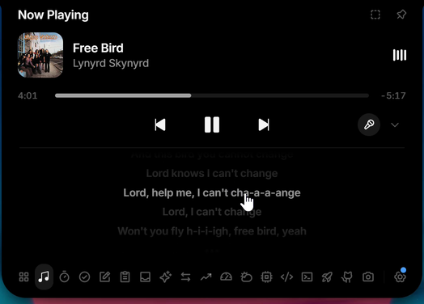

## Overview, weather and Discord

- **Overview** is a small control center: time, weather, what is playing right now, Windows focus, keep awake and a volume slider. With more than one playback device, the button at the end of the slider lists them and makes the one you pick the Windows default.
- **Keep awake** stops the PC and the display from going to sleep. A tap keeps them awake until you turn it off; the arrow on the card picks 30 minutes, 1 hour or 2 hours instead, and the card shows the time left. A timed one ends by itself. While it is on, a small cup shows in the closed notch. It always starts off when NotNotch starts, and NotNotch lets the PC sleep again when it quits.
- **Weather** gives current conditions and a 7-day forecast through Open-Meteo. No API key needed.
- **Discord** shows your current voice call with speaking members and buttons for mute, deafen and hang up. In the closed notch, a green equalizer plays while someone talks.

<table>
  <tr>
    <td>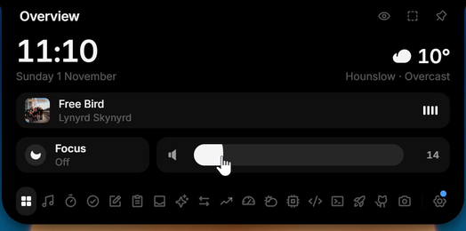</td>
    <td>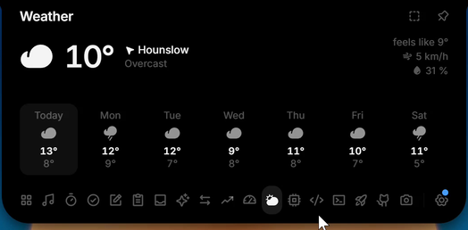</td>
  </tr>
</table>

## Productivity tools

- **Timer** with focus and break presets, custom durations, six alarm sounds and a running countdown in the closed notch. An expired timer stays visible until you dismiss it. A focus timer can play a background sound while it runs (white, pink or brown noise, rain or waves, generated on the fly without audio files), which fades in at the start and out when the timer ends, pauses or resets; the speaker button in the Timer mutes it until NotNotch restarts.
- **To-dos** and **notes** live on your machine and need no account. A to-do can have a due time; when it comes, an alarm sounds (unless you turn the sound off) and the to-do shows in the closed notch until you snooze it or mark it done.
- **Clipboard** keeps a history of text, links, images and files, with filters and previews. Password managers are excluded on purpose, and nothing is written to disk.
- **Shelf** is a parking spot for files. Drop them onto the notch or press Ctrl + V, then open, copy or reveal them later.
- **Scratchpad** is a code pad with syntax colouring for JavaScript, TypeScript, Rust and Python, or plain text. Each language keeps its own draft, saved as you type.
- **Water** logs what you drink against a daily goal (2 L unless you change it), with an hourly chart. Reminders are optional: every hour, or the interval you pick, between the times you set.
- **Converter** handles units (length, weight, temperature, volume, speed) and currencies at the European Central Bank's reference rates, about 30 currencies updated every working day. Any two currencies convert through your portfolio's base currency, which is also the default. It opens on the units and currencies you used last.

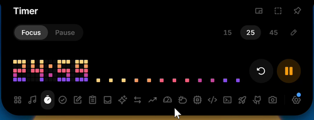

<table>
  <tr>
    <td>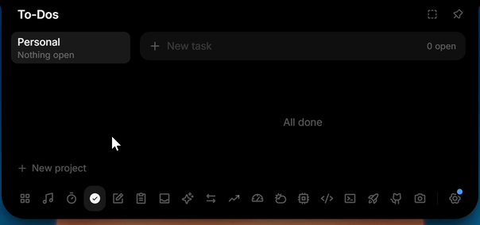</td>
    <td>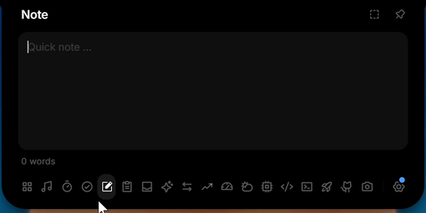</td>
  </tr>
  <tr>
    <td>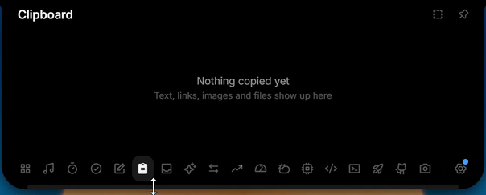</td>
    <td>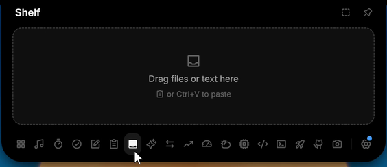</td>
  </tr>
  <tr>
    <td>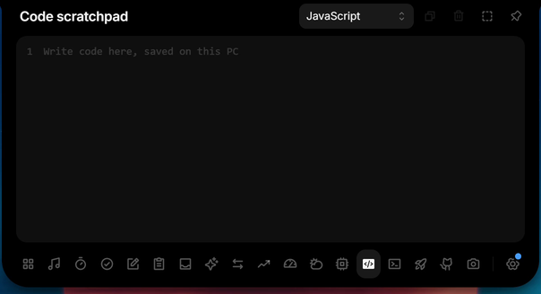</td>
    <td>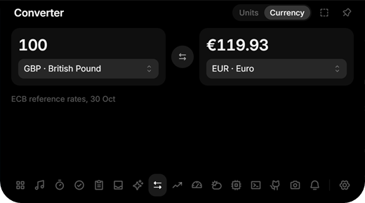</td>
  </tr>
</table>

## Capture

- **Screenshots** of all screens, one screen or a region you drag, saved as PNG in Windows' *Screenshots* folder (Pictures\Screenshots, with the ones Win+PrtScn takes) and copied to the clipboard, optionally onto the Shelf too.
- **Recordings** of a screen or a window to MP4 in *Videos\NotNotch\Recordings*, at 30 or 60 fps, with system audio and the microphone if you want them.
- While it records, the closed notch shows the time with pause and stop buttons.
- NotNotch keeps itself out of its own screenshots and recordings; other apps that record or share the screen still see it.
- The tool lists what you took, with thumbnails and lengths; a deleted capture goes to the Recycle Bin.
- **Find on screen** (Ctrl+Alt+F, changeable in **Settings → Window**) reads the text on every screen with Windows' own text recognition, in your Windows languages or else English, and opens a search over it. Each result shows its line and screen; a click copies the line, the crosshair draws a frame around it on screen for two seconds. The screens are read in memory only, nothing is saved, and the text is gone when the page closes.

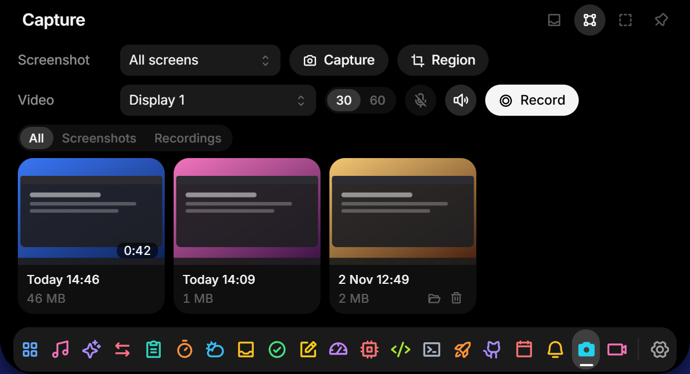

## Camera

A mirror for checking your hair and the light before a call, off by default. The tool shows the webcam picture, mirrored unless you turn that off in its header, and with several cameras a menu there picks one, which NotNotch remembers. The camera is on only while the tool is on screen: switching tools, closing the notch or hiding NotNotch turns it off. The picture is never recorded, saved or sent, and NotNotch's own use does not light the camera privacy dot. If Windows blocks the camera, the tool says where to allow it (Settings, Privacy & security, Camera), and it tells you when another app is holding the camera.

## Terminal

- Runs PowerShell 7, Windows PowerShell or Command Prompt inside the notch, with a start folder and font size of your choice.
- The session can keep running while the notch is closed.

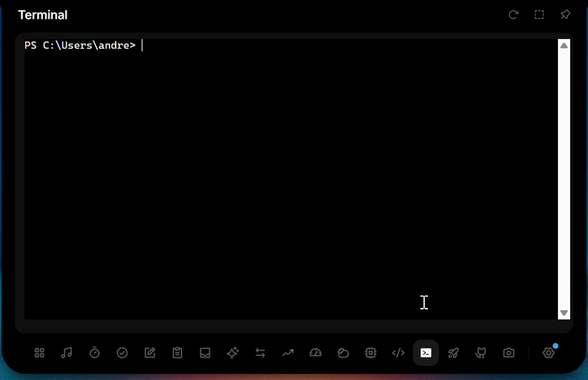

## Launcher and GitHub

- **Launcher** lists your pinned apps (detected AI apps such as Claude, ChatGPT and Cursor are pinned on first use) and starts them with a click. Any Start menu entry can be pinned.
- If you opt in, the first six also open with **Alt + 1** to **Alt + 6**, which then no longer reach other apps.
- **GitHub activity** shows the contribution calendar of a public username for the last 36 weeks, with the yearly total, today's count and your current and longest streak. A part in the closed notch shows today's count.
- It reads the public contribution page once an hour; a token without any rights is only needed if that page cannot be read.

<table>
  <tr>
    <td>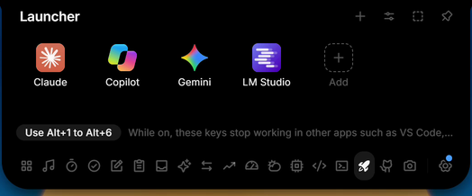</td>
    <td>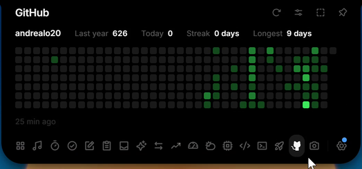</td>
  </tr>
</table>

## Calendar

- **Calendar** shows the month on the left, with a dot under each day that has events in the colour of its calendar, from the previous month to two months ahead. On the right, the agenda from the picked day (today unless you click another) and the next six days: each event with its calendar's colour, the time (or "All day") and the place. Past events of today are dimmed; a click on the month's name goes back to today.
- Sources are ICS links (the secret iCal address from Google Calendar, Outlook or iCloud, or any `webcal://` link) and CalDAV accounts (Nextcloud, Fastmail, iCloud, Radicale and others). It only reads; nothing is ever written back.
- Recurring events are expanded in their own time zone (daily, weekly, monthly and yearly rules with intervals, counts, end dates and weekdays), with skipped and moved instances. Time zones can be IANA names, Windows names (Outlook) or ones defined in the file.
- A notice in the closed notch 5 or 10 minutes before an event, and an optional **Next event** part that shows the title and time once an event is within 30 minutes to 8 hours.
- An event with a Google Meet, Zoom, Teams or Webex link in its URL, place or description gets a **Join** button in the agenda and in its notice, which opens the meeting in your browser and hides the notice.
- The last good result is kept on disk, so the agenda still shows offline; a calendar that fails keeps its last events and shows the error in the settings.

## AI chat and usage

- **Ask** is a chat with Claude, ChatGPT, OpenRouter or any OpenAI-compatible endpoint, with streaming and adjustable reasoning effort.
- **AI usage** shows your subscription limits for Claude, ChatGPT, Antigravity, Cursor and the Z.ai coding plan, and credits and balances for OpenRouter and DeepSeek.
- It also shows the tokens and cost of Claude Code and Codex today and over 7 days, read from their local logs. A models page breaks tokens and cost down per model for today, 7 or 30 days.
- Cards can be reordered, renamed, added and removed.

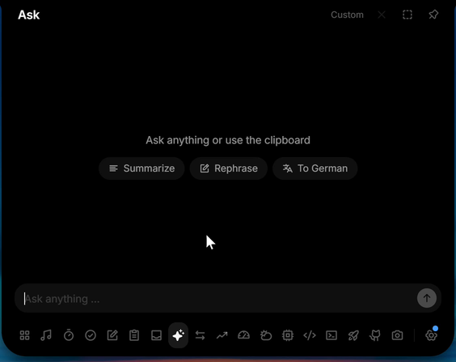

## Hardware monitor

- **Hardware** shows live CPU, RAM, GPU, VRAM, network, power draw, battery, temperatures, ping, the busiest processes and your drives, with history that keeps recording while the notch is closed.
- Readings your PC cannot give (a battery on a desktop, a missing sensor) are left out.
- The **Power** row has a small menu with the Windows power plans: pick one to switch to it. It only shows when the PC has more than one plan; many Windows 11 PCs only have Balanced.
- Many PCs give Windows no CPU temperature, so while HWiNFO or LibreHardwareMonitor runs, NotNotch reads CPU and GPU temperature and power from it and Hardware names it as the source (in the power row, or when you point at a temperature). In HWiNFO, turn on **Shared Memory Support** in its settings (the free version switches it off after 12 hours); LibreHardwareMonitor only needs to be running.
- **Gaming mode** adds FPS to the readings in the closed notch, always or only while a fullscreen app runs. FPS works for DirectX, OpenGL and Vulkan games.
- Windows only allows FPS readings for members of the *Performance Log Users* group: click **Settings → Display → Unlock FPS** once, confirm the Windows prompt, then sign out and back in. A lock icon in the notch means this step is still missing.

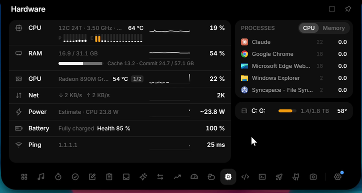

## Portfolio

- Combines Trading 212, Kraken, Coinbase, Binance, Bitpanda, eToro, Interactive Brokers and holdings entered by hand in one base currency.
- Profit and loss per account and in total, and a history chart.
- The app only reads, it never trades or moves funds.

<table>
  <tr>
    <td>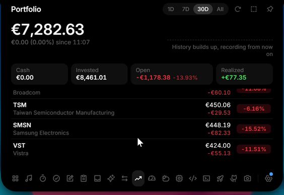</td>
    <td>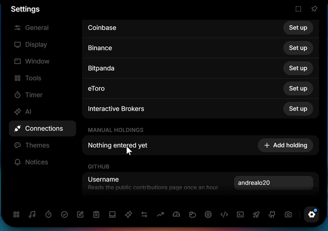</td>
  </tr>
</table>

## Vault

Passwords and two-factor codes, one hover away and encrypted on your PC.

- **Passwords** with name and username or email. Copy either one with a click, show or edit the password, or let the generator create a strong one.
- **2FA codes** with a live countdown. Screenshot the QR code (Win + Shift + S) and press **Ctrl + V**, or type the key, then name it.
- **4-digit PIN** before anything secret is shown or copied, adjustable for passwords and 2FA separately in **Settings → Tools → Vault**. Five wrong tries lock it for 30 seconds, doubling from there.
- **Never in clipboard history.** Copies skip the NotNotch clipboard and Windows' Win + V history, and passwords and codes leave the clipboard after 30 seconds.
- **Local only**, encrypted with Windows DPAPI and bound to your Windows account. Forgot the PIN? **Reset vault** in settings deletes everything; there is no back door.
- **Windows Hello (optional):** unlock with face, fingerprint or Windows PIN instead of the vault PIN. Secrets are then additionally encrypted with a key from your PC's security chip, so even malware running as you can't read them without your confirmation.

The vault is off by default; turn it on under **Settings → Tools**.

## Themes

- Fifteen built-in panel themes (Dark, Light, One Dark Pro, GitHub Dark, GitHub Light, Dracula, Night Owl, Catppuccin Mocha, Catppuccin Latte, Nord, Rosé Pine, Rosé Pine Dawn, Gruvbox Dark, Solarized Light and Everforest) under **Settings → Themes**.
- The editor changes background, foreground, accent and the warning colours with a colour picker and shows each change on the panel at once.
- Save the result as your own theme, export and import themes as JSON files, or switch between a day and a night theme by time.
- The closed notch stays black unless a theme opts in to colour it.
- **Coloured icons** (off by default) gives each tool in the tool bar, each Settings page, the weather, the Overview tiles, the Hardware rows and the closed-row readings a colour of its own. The colours are worked out for the active theme so they keep at least 3:1 contrast, on light and custom themes too.
- Tint from the album art (off by default) gives the open panel a soft glow of the cover's colour from the top while a song shows, fading between songs and behind the content, so text keeps the theme's contrast.

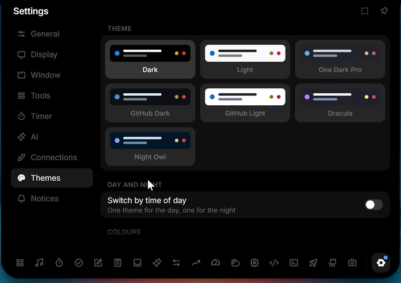

Details: [themes.md](themes.md).

## Live notices and notnotch-notify

- Turn on **Settings → Notices** and Windows notifications from any app show in the closed notch for 6 seconds, with the app's logo, name, title and text, and land on a **Notices** page in the open notch.
- Each app can be shown, muted (history only) or turned off.
- Presentation mode, a full-screen app, Windows focus or Do Not Disturb, and an optional daily quiet window keep them in the history without popping up.
- Scripts, builds and coding agents can send their own notices with `notnotch-notify`, including `notnotch-notify run -- <command>` for the exit code and duration.
- `notnotch-notify part` sets a custom part of the closed row (icon, text up to 48 characters, progress, a tool to open on click, an optional time to live); turn on **Script parts (notnotch-notify)** among the closed-row parts.
- `notnotch-notify ask` shows a question with up to four buttons (by default **Allow**, **Always allow** and **Deny**) and prints the one you click, so a coding agent's permission request can be answered from the notch. It stays until answered or its time runs out (2 minutes by default), and with no answer the caller falls back to its terminal prompt.

Details, ready-made hooks for Claude Code and Codex (including a permission hook that uses `ask`), and how notifications are read: [notices.md](notices.md).

## Plugins

- A plugin is a small HTML, CSS and JavaScript widget in a folder with a `notnotch-plugin.json`. Install one from a folder or a `.zip` in **Settings → Plugins**; it becomes a tool with its own icon in the tool bar.
- Before installing, NotNotch shows what the plugin asks for: the addresses it may fetch from, its own storage, and notices in the closed notch. Nothing else is possible: no files, keys, vault, clipboard, settings or other plugins.
- Plugin pages run in a sandboxed frame that cannot reach the network itself; NotNotch fetches for them, only over https and only from the hosts they declared.
- Switch a plugin off like any tool, or remove it with its data in **Settings → Plugins**. A sample plugin is in `examples/plugins/hello-notnotch`.

Format, API, limits and the security model: [plugins.md](plugins.md).

## Screen edges, window rules and panel size

- **Any screen edge.** **Screen edge** in **Settings → Display** hangs the notch and the line from the top, bottom, left or right edge, from the screen's edge or from the taskbar's. Dragging the closed notch towards another edge moves it there. The capsule stays on the top.
- **More monitors.** **Monitor** in **Settings → Display** (shown with two or more monitors) puts the notch on one monitor, or picks **Follow the cursor** or **All monitors**. Following, the closed notch moves to the monitor the pointer has stayed on for about a third of a second, so crossing a screen edge does not move it; it never moves while open, peeking, dragged or recording. With All monitors every other monitor shows a copy of the closed notch, updated a few times a second; hovering it brings the notch there, where it opens as usual, and the copy moves to the monitor the notch left. The edge, the anchor and the offset are the same everywhere, each monitor with its own size, scale and taskbar, and monitors plugged in or out are picked up within a second. A copy hides with the hide shortcut, and on its own while the app in front on its monitor calls for the line or hiding under the window rules. Each copy is one more WebView2 window, about 70 MB more memory.
- On the left and right edges the parts stand in a column, and a notice shows as one icon: a finished timer (click to dismiss), a status alert, a live notice's app logo or a due to-do (click to open the To-dos).
- **Screen and app rules.** **Settings → Window** chooses what NotNotch does while a maximized window, a borderless full-screen app or an exclusive full-screen game covers its monitor: keep its look, turn into the line, or hide. It can also check the windows behind the one in front. Rules per app, picked from the running apps or typed, override these.
- **Panel size and scale.** Drag the open panel's sides, bottom or bottom corners to size each tool (double click resets), or pick Compact, Standard or Spacious for all of them. The whole notch can be shown at 100 % or 150 %.

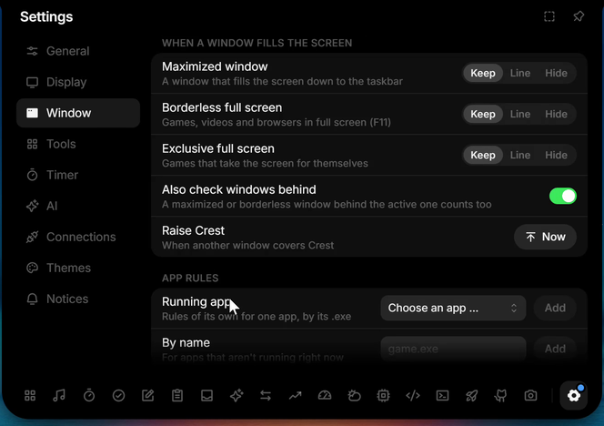

## Shortcuts

- Opening and closing, hiding and showing NotNotch, resizing the panel with the arrow keys and Find on screen each take a shortcut you record in **Settings → Window**.
- NotNotch tells you when another program or the launcher's Alt keys already use it.
- Opening NotNotch on purpose (shortcut, tray, a second launch) shows it even while a rule hides it, until it closes again.
- Right click on the notch opens the settings, and the mouse wheel switches tools.

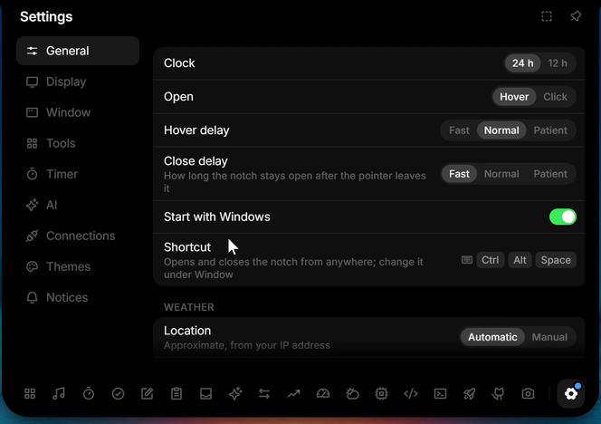

## Portable build

- A zip that runs from any folder you can write to, with nothing installed and its data in a folder next to it. See [Install](../README.md#install).

## Using it

| Action | How |
| --- | --- |
| Open or close | Hover, click or **Ctrl + Alt + Space** (choose the trigger in settings) |
| Switch tools | Tool bar at the bottom of the open notch |
| Settings | Gear icon at the end of the tool bar, or **Settings …** in the tray menu |
| Tray icon | Left click opens the notch, right click shows the menu (open, settings, autostart, quit) |
| Move the notch | Drag it along its edge, closed or by its header; drag the closed notch towards another edge to move it there. "Reset to center" is in settings |
| Focus mode | Click the notch three times quickly. It turns half transparent and clicks pass through. Three more clicks bring it back |
| Add files | Drag them onto the notch, or paste with Ctrl + V |

## Settings

Settings are grouped into General, Display, Window, Tools, Timer, AI, Connections, Themes and Notices. The search field above the pages (**Ctrl + F**) finds a setting by its name, its description or its group, in the interface language or in English, and a click opens its page with the setting highlighted. There you can reorder (drag) or hide tools, pick the monitor and the screen edge, set what the notch does over full-screen and maximized windows, record shortcuts, and enable autostart. Language, in General, is English (the default) or Bahasa Indonesia; it switches at once, tray menu included, and numbers and dates follow it.

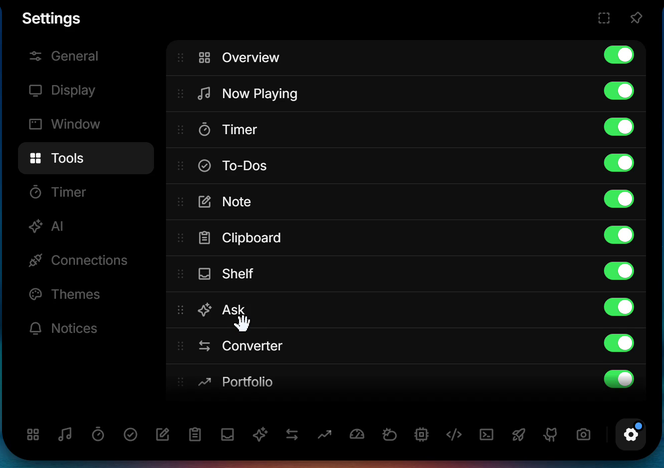

### Setting up the integrations

Every integration is optional. Tools you don't connect simply stay out of your way.

**Ask (AI chat).** Under **AI**, choose a provider (Claude, ChatGPT, OpenRouter or a custom endpoint) and paste your API key. For a custom endpoint, enter the base URL (usually ending in `/v1`) and a model ID. The reasoning effort is set there too.

**AI usage.** Nothing to enter. If you are signed in to Claude Code, the Codex CLI, the Antigravity CLI (`agy`) or Cursor on this PC, NotNotch reads their existing local login and shows your limits. For Antigravity it asks the CLI itself and never touches its login.

OpenRouter, DeepSeek and Z.ai need an API key, entered under **AI** once the card is switched on (OpenRouter uses the same key as Ask). Token cost is estimated at the API list price of each model; for models the built-in table does not know, click the cost on the models page and set a price by hand. With a subscription the figure is what the same tokens would cost on the API, not what you pay. After a rate limit (HTTP 429) a source pauses for 2 to 30 minutes, or as long as the service asks, and keeps showing its last reading.

**Portfolio.** Under **Connections** pick the base currency and set up each account with a key that can only read; each provider lists the exact rights to tick (for Trading 212: account data and portfolio; Kraken: Query Funds and Query Ledger Entries; Coinbase: an ECDSA key with View only; Binance: Enable Reading only; Bitpanda: Balances; eToro: a Read key; Interactive Brokers: a Flex Web Service token and an Activity Flex Query with Open Positions and Cash Report). Coins entered by hand are priced by CoinGecko; stocks and ETFs entered by hand use the price you type, since there is no free documented stock quote source. Degiro, Trade Republic and Scalable Capital have no official API and are not supported.

**Discord.** Discord only hands out voice permissions to your own application:

1. Create an application at [discord.com/developers](https://discord.com/developers).
2. Under OAuth2, copy the **Client ID** and **Client Secret** into **Connections**.
3. Under OAuth2, Redirects, add `http://localhost` and save. Without it Discord keeps asking for permission again.
4. Join a call. Discord asks you once to confirm.

**Calendar.** Under **Connections**, add a calendar:

- *ICS link.* Google Calendar: Settings, your calendar, Integrate calendar, **Secret address in iCal format**. Outlook: Settings, Calendar, Shared calendars, **Publish a calendar**, then the ICS link. iCloud: share the calendar as a **Public Calendar** and copy the `webcal://` link. The link is stored in the Credential Manager, since anyone with it can read the calendar.
- *CalDAV.* The server (for example `https://caldav.icloud.com`, or your Nextcloud or Fastmail CalDAV address), the user name and an app password (for iCloud: appleid.apple.com, Sign-In and Security, App-Specific Passwords). NotNotch finds the account's calendars on its own; a calendar's own address works too.

Then switch on the Calendar tool. The notice and the **Next event** part's horizon are set in the same section; the part itself is switched on under **Display**.

**Weather.** Works out of the box with your approximate location (city level, from your IP), looked up at each start while the location is automatic and the weather shows (the Weather tool or Overview). The locate button in the tool looks it up again; pick a city by hand to stop the lookups.

## Install in detail

**Microsoft Store.** [NotNotch](https://apps.microsoft.com/detail/9N2KXJ2924KS) is the Store build: Microsoft signs it and the Store installs its updates, so it has no update check of its own and no portable copy. Start with Windows goes through the package and stays off until you turn it on.

**Installer.**

1. Download `NotNotch_x.y.z_x64-setup.exe` (on a Windows on ARM PC, `NotNotch_x.y.z_arm64-setup.exe`) from the [latest release](https://github.com/latiefahmad/notnotch/releases/latest).
2. Run it. No Node, Rust or admin rights needed; it installs for your user only.
3. The notch appears at the top of your screen and starts with Windows from then on.

The installer is not code-signed yet, so Windows SmartScreen may warn on first launch. Click **More info → Run anyway**.

**Portable zip.** Download NotNotch-x.y.z-Portable-x64.zip (or NotNotch-x.y.z-Portable-arm64.zip on ARM) instead, unzip it anywhere you can write to and run NotNotch.exe. Nothing is installed: settings, notes and caches stay in a data folder next to it, notnotch-notify.exe comes along, and updates replace both in place after checking their signature. Start with Windows is off for a portable copy until you switch it on. API keys stay in the Windows Credential Manager of each PC. Details are in README-portable.txt inside the zip.

**Checksums.** Each release has a `SHA256SUMS` file listing the SHA-256 of every file in it. `sha256sum -c SHA256SUMS --ignore-missing` checks the files you downloaded; in PowerShell, compare `Get-FileHash <file>` with its line.

NotNotch keeps its settings and data apart from L4-Notchbar, so both can be installed at the same time.

**Requirements.** Windows 11 or Windows 10, 64-bit, on an x64 or ARM64 PC. Built and tested on Windows 11; Windows 10 should work but is untested. NotNotch uses WebView2; if it is missing, the installer fetches it automatically.

**Crash log.** If NotNotch crashes, panics and uncaught interface errors are appended to `crash.log` in `%LOCALAPPDATA%\io.github.latiefahmad.notnotch\logs` (installer), or in `data\logs` next to NotNotch.exe (portable). Past 512 KB it is renamed to `crash.old.log` and a new one starts. The file stays on your PC; attach it to a bug report if you like.

**What's new.** After an update, a line in the closed notch says what version you are on now; when the daily check finds a new version (not in the Store build, which the Store updates), the line says it is available. A click opens a page with the changes, a short note on supporting the project with a GitHub Sponsors button, and for a new version an Update now button. The ✕ hides the line for that version, and a fresh install shows nothing.

**Copy diagnostics.** Settings, General, Updates has Copy diagnostics, which puts a short plain-text block on the clipboard for a bug report: the app version and build (installer, portable or Store), the Windows edition and build, the app's and the PC's architecture, the number of monitors and their scale, the panel scale, the enabled tools, the closed style and edge, and the codes of current errors (update check, GitHub, FPS, Discord). It never includes your user name, the PC's name, file paths, keys, tokens, account names or your location; an error that is not one of NotNotch's own codes shows as `other`.

## Keys and the vault

- **Keys and secrets** are stored in the Windows Credential Manager under "NotNotch/…", never in a plain file, and they are never sent back to the interface. On the first start NotNotch copies keys it finds under "Notch/…" (where older versions and L4-Notchbar keep them). Those originals stay where they are: deleting a key in NotNotch does not remove them, so remove them in the Credential Manager if you no longer need them.
- **The vault** lives in one file encrypted with Windows DPAPI, readable only under your Windows account. The PIN is checked in the app's backend, not in the interface, and 2FA keys never leave the backend. With Windows Hello turned on, secrets are additionally sealed with AES-256-GCM under a TPM-backed Windows Hello key.

What goes over the network, and when: [PRIVACY.md](../PRIVACY.md).
