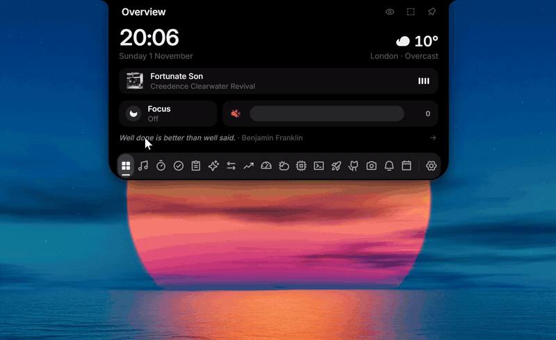

The first public release of NotNotch: a notch at the edge of your Windows screen with music and synced lyrics, notices, timers and to-dos, screenshots and screen recording, a terminal, an app launcher, your GitHub activity, AI usage limits, live hardware stats, a read-only portfolio across brokers, themes and more. NotNotch grew out of L4-Notchbar 1.6.0 and now has its own name, updates and settings.

Every tool, with a picture of each, is in the [README](https://github.com/latiefahmad/notnotch#features). Download the installer below, or the portable zip if you would rather not install anything.

## The closed notch and its readings

- The closed notch comes as a notch, a capsule or a line, on any screen edge. Settings → Display sets the width and height of the notch and capsule, how far the capsule sits from the edge, and the line's length, thickness and distance; the content grows with the height, and the surface widens by itself when the content needs more room. The closed notch can also be resized on itself: Adjust on the notch, drag its ends and its far side, Done.
- The row shows cover, timer, Discord call, AI quota, title or lyrics, hardware, equalizer, clock and GitHub, each percentage next to its own icon, with coloured icons as an option. A click or a hover on a part opens its tool: the readings Hardware, the AI rings AI Usage, the song Now Playing, the timer or clock the Timer, the next event the Calendar, your profile picture your profile.
- Volume and brightness changes show in the notch, and NotNotch can stand in for the Windows indicator; turning that option off brings the Windows indicator back. A button on the volume tile in Overview picks the audio output. Overview also has a brightness slider for the screen the notch is on, over DDC/CI on external monitors and through Windows on a laptop's own screen (on a Mac, the built-in display), and a Keep awake tile.
- Caps Lock and Num Lock show in the notch when you press them, like the volume. A browser download shows its size and speed while it runs, and a notice offers Show in folder and Add to Shelf when it is done. After an update, a line in the closed notch says what changed and opens this page.

## Notices

Notices in the notch cover recording, timer, status alerts, quota, to-dos and water. A Windows notice opens its app on a click, and deleting it in NotNotch removes it from the notification centre too; Bluetooth devices (headphones, mice, keyboards, controllers, speakers, phones) announce connects and disconnects with their battery when they report one. A click on any notice opens what it is about: a recording opens Capture or the Recorder, a quota alert opens AI usage, a new track opens Now Playing. `notnotch-notify ask` shows a question with Allow, Always allow and Deny in the notch and waits for your answer, so a coding agent's permission request is answered from the notch; docs/notices.md has a ready-made hook.

## Now Playing

Synced lyrics line by line, word by word where the source times words, with translation and romanisation for Japanese, Chinese and Korean, from more sources to look in. The equalizer is fed only by the player, with Spectrum and Wave styles and a Wavy progress bar, and the open panel can take a soft tint of the album art's colour. A picker chooses which player to follow.

## Capture

- Screenshots and screen recording, with system audio and microphone.
- Recorder: records sound only, from the microphone, the system audio or both mixed, so a call keeps your voice and everyone else's. Files are M4A in Music\NotNotch\Recordings, listed in the tool with their length, and pause, stop and the timer in the closed notch work as for screen recordings. It is off by default: turn it on in Settings, Tools. NotNotch tells no one that you are recording; the first time you open it, a note reminds you that in many countries a conversation may only be recorded with everyone's consent.
- Camera: a tool, off by default, to check yourself before a call. The picture stays on your screen and is never recorded.
- Find on screen: Ctrl+Alt+F reads every screen with Windows' own text recognition and lets you search and copy what is on them. Nothing is saved or sent.

## Calendar

A read-only agenda from ICS links (Google, Outlook, iCloud) or CalDAV accounts, a month next to it with a dot for each calendar on the days that have events, notices before each event, and Join buttons for Google Meet, Zoom, Teams and Webex links, in the agenda and in the notice.

## Tools

- Terminal: PowerShell or Command Prompt, in the notch. When the sign-in of a command line AI tool has expired, Renew starts it in this terminal.
- Launcher: pinned apps and a search, with your GitHub activity next to it.
- AI usage: tokens and cost from local logs, across the providers you use. When a reading is out of date, the tool says why and dims the old limits instead of showing them as current.
- Hardware: cores, GPUs, network, power, battery, temperatures, processes and drives, with each process's CPU share in percent, the Windows power plan when the PC has more than one, and temperatures and power from HWiNFO or LibreHardwareMonitor while one of them runs.
- Portfolio: several brokers in one base currency, read only.
- Converter: units and currencies, about 30 of them at the European Central Bank's reference rates, opening on what you used last.
- Weather: a forecast that keeps the last one for when the service doesn't answer, and says how old it is.
- To-dos with due times, a water reminder, a code scratchpad, Shelf for drops and a clipboard history with formats.

## Timer, clock and themes

- Clock look: the Overview clock wears any of the timer looks.
- Timer looks: Flip, Nixie, Ring, LCD and Analog join the looks there were, and Settings → Timer picks a colour for the focus timer (orange stays the default, breaks stay green) and one for the Overview clock.
- Focus sounds: white, pink and brown noise, rain and waves play while a focus timer runs and fade out when it ends. Settings → Timer.
- Settings search: type in the field above the pages, or press Ctrl+F while Settings is open.

## Themes and languages

- Themes with an editor, a day and night switch, and fifteen themes to pick from.
- Coloured icons across the app, worked out for the theme you use, so they keep 3:1 contrast on light and custom themes too; Settings → Themes → Coloured icons.
- Fonts: Settings → Themes → Font picks the font of the whole app from sixteen, each shown as itself in the menu. Inter stays the default; the others come with Windows, and on a Mac each one uses a Mac font of the same kind. Fonts with uneven digits use Inter's digits, so timers and the clock do not jitter.
- NotNotch in eleven languages (English and Simplified Chinese, Spanish, Hindi, Arabic right to left, French, Portuguese, Russian, Japanese, German and Italian), following Windows unless you pick one in Settings, General; notice times and dates and 12-hour times follow the language.

## Setup, updates and platforms

- First run: a short setup picks a preset (Music, Productivity, AI or your own tools), the closed look and edge, and shows the shortcut. Settings → General runs it again.
- Plugins: a folder of HTML, CSS and JavaScript with a `notnotch-plugin.json` becomes a tool in the notch, installed from Settings → Plugins. It runs sandboxed, with only the network addresses and storage it declares. How to write one: [docs/plugins.md](https://github.com/latiefahmad/notnotch/blob/main/docs/plugins.md).
- Downloads: ARM64 installers and portable zips, a `SHA256SUMS` file to check them, Copy diagnostics in Settings for a bug report, and a portable build that keeps its data next to it and updates itself in place.
- Mac preview: disk images for Apple silicon and Intel Macs. This is a first preview, not notarized and barely tried on real hardware, so expect rough edges and please open an issue for what breaks. Shelf, Hardware, Discord, Vault, Terminal, Launcher, Notices and Capture are Windows-only for now and don't show on a Mac.

## Keeping the screens smooth

- With more than one monitor the notch stays on the monitor you pick, follows the pointer, or shows a closed notch on every monitor that opens where you touch it.
- Opening the notch and switching tools skip the panel blur, which cost a long frame on every open on high-DPI screens.
- Menus keep each choice on one line, so long window titles in Capture no longer overlap.
